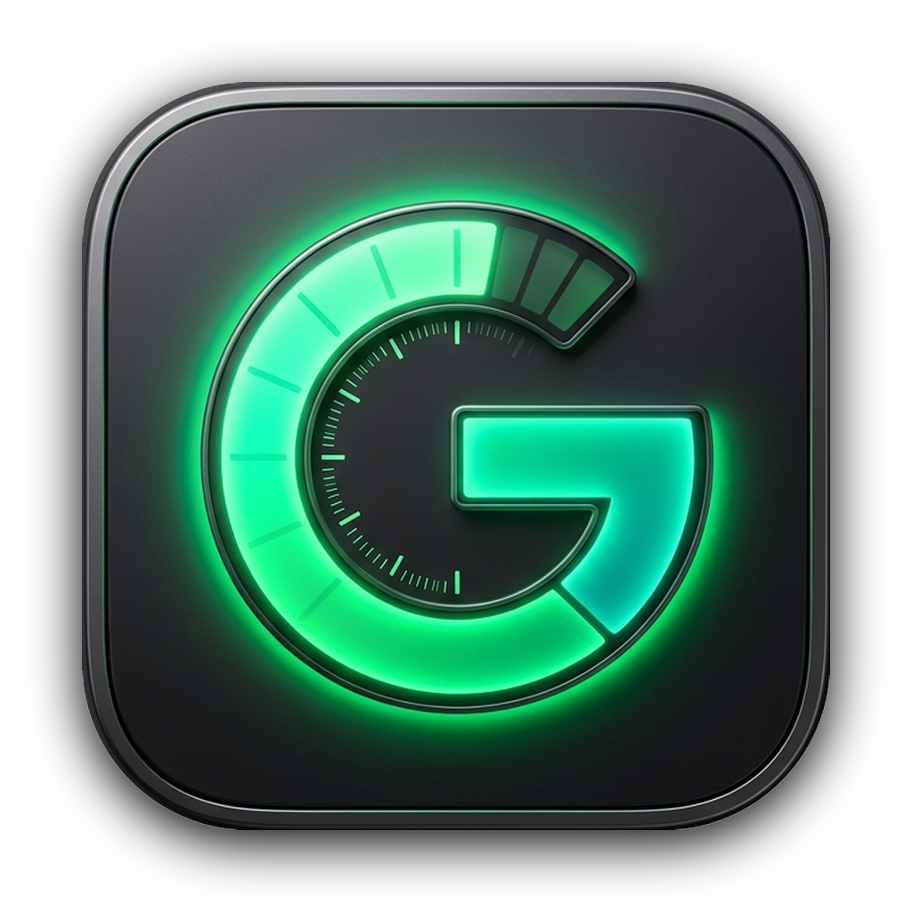

<div align="center">

# ⚡ Gemini Gauge

### Multi-Platform AI Quota & Rate Limit Monitor for macOS, Linux & Windows
**Developed by [VH2C](https://vh2c.com.br)**

[](https://github.com/vh2c/gemini-gauge/releases)
[](https://github.com/vh2c/gemini-gauge/releases)
[](LICENSE)
[](#)
[](https://vh2c.com.br)

<br/>



<br/>

**Gemini Gauge** is a lightweight, high-performance desktop application designed to monitor your AI model quotas and rate limits in real time. It operates **completely independently of any IDE**, aggregating usage across **Google Gemini API**, **Antigravity IDE (Live & Headless)**, **OpenAI**, and **Anthropic Claude**.

</div>

---

## 🌟 Key Highlights

- **🎯 True Multi-Provider Aggregation**:
  - **Google Gemini API**: Direct connection to Google AI Studio (RPM, TPM, model availability).
  - **Antigravity (Live & Headless)**: Detects live running IDE instances, or executes an instant standalone headless probe when closed.
  - **OpenAI API**: Tracks Request-Per-Minute (RPM) and Token-Per-Minute (TPM) limits (GPT-4o, o1, etc.).
  - **Anthropic Claude API**: Tracks Sonnet, Opus, and Haiku request/token quotas.
- **⚡ Two Distinct Display Modes**:
  - **Full Detailed Window**: Dark Obsidian theme (`#181818`), status progress bars, real-time counters, and countdown reset timers.
  - **Radial Tachometer HUD**: Sleek floating meter dock with circular analog gauges, ticks, needles, and status colors. Can be docked vertically or horizontally.
- **⚙️ Integrated Graphical Settings**:
  - Click the **Configurar (⚙️)** button to easily toggle providers and paste your API keys without editing raw JSON files.
- **🚀 Zero-Friction Installation**:
  - Native installer scripts for macOS, Linux, and Windows that handle dependencies automatically.

---

## 📸 Display Modes

### 1. Full Detailed Window
A desktop window detailing each AI model group, active quota percentages, and exact time remaining until limit renewal.

### 2. Radial Tachometer HUD
A floating, always-on-top telemetry widget styled like high-end automotive tachometers:
- **Green (`#00E699`)**: Quota Healthy (50% - 100%)
- **Amber (`#F5A623`)**: Moderate Usage (20% - 49%)
- **Red (`#FF4D4F`)**: Low Quota Warning (< 20%)

| Shortcut | Action |
| :--- | :--- |
| `Cmd + M` (Mac) / `Ctrl + M` (Linux/Win) | Toggle between **Full Window** and **Radial HUD** |
| `Cmd + O` (Mac) / `Ctrl + O` (Linux/Win) | Toggle HUD orientation between **Vertical** and **Horizontal** |
| `Cmd + R` (Mac) / `Ctrl + R` (Linux/Win) | Refresh all quota metrics immediately |
| `Cmd + ,` (Mac) / `Ctrl + ,` (Linux/Win) | Open the **Settings (⚙️)** Dialog |
| `Cmd + W` / `Esc` | Close / Hide window to system tray |

---

## 🚀 Quick Download & Installation

### 🍏 macOS (Apple Silicon & Intel)
1. Download the latest release: [Gemini-Gauge-macOS-vh2c.zip](https://github.com/vh2c/gemini-gauge/releases/latest)
2. Extract the ZIP and move **`Gemini Gauge.app`** to your `/Applications` folder.
3. Open `Gemini Gauge` from Spotlight or Launchpad!

*Or build directly from source:*
```bash
git clone https://github.com/vh2c/gemini-gauge.git
cd gemini-gauge/macos
./install.sh
```

---

### 🐧 Linux (Ubuntu, Debian, Fedora, Arch, Mint)
The Linux installer is **100% self-contained** and automatically configures dependencies (including a portable Node.js runtime if missing, requiring zero root/sudo permissions for Node):

```bash
# 1. Clone the repository
git clone https://github.com/vh2c/gemini-gauge.git
cd gemini-gauge/linux

# 2. Run the smart installer
./install.sh
```

- **Run GUI**: Open `Gemini Gauge` from your system applications menu, or run `gemini-gauge` in terminal.
- **Run Headless / SSH CLI**:
  ```bash
  gemini-gauge --cli
  ```

---

### 🪟 Windows (Windows 10 / 11)
1. Download the latest release: [Gemini-Gauge-Windows-vh2c.zip](https://github.com/vh2c/gemini-gauge/releases/latest)
2. Extract the ZIP.
3. Right-click **`install.ps1`** and choose **"Run with PowerShell"** (or double-click `GeminiGauge.bat`).
4. Shortcuts with the official icon will be created on your **Desktop** and **Start Menu**.

---

## ⚙️ Configuration Tutorial

### Option A: Via GUI (Recommended)
1. Launch **Gemini Gauge**.
2. Click the **`Configurar (⚙️)`** button at the bottom of the window.
3. Check the providers you want to monitor:
   - **Google Gemini API**: Paste your API key (get one free at [aistudio.google.com/app/apikey](https://aistudio.google.com/app/apikey)).
   - **Antigravity**: Keep checked to monitor your IDE quotas (works even when closed).
   - **OpenAI**: Paste your OpenAI API key (`sk-...`).
   - **Anthropic**: Paste your Claude API key (`sk-ant-...`).
4. Click **Salvar e Atualizar**.

### Option B: Via Config File
Edit `~/.config/UniversalAIQuota/config.json`:

```json
{
  "providers": {
    "antigravity": {
      "enabled": true
    },
    "gemini": {
      "enabled": true,
      "api_key": "AIzaSy..."
    },
    "openai": {
      "enabled": false,
      "api_key": "sk-proj-..."
    },
    "anthropic": {
      "enabled": false,
      "api_key": "sk-ant-..."
    }
  },
  "refresh_interval_seconds": 30
}
```

---

## 📊 Telemetry & Privacy

Gemini Gauge sends a lightweight, anonymous heartbeat ping upon startup to:
`https://api.vh2c.com.br/v1/geminigauje`

- **What is sent**: Anonymous device hash (`machine_id`), operating system (`macOS`/`Linux`/`Windows`), architecture, and application version.
- **What is NEVER sent**: Your API keys, model prompts, code, project files, or personal information.
- **Purpose**: Global user count statistics and checking for new software updates.
- If offline, the ping fails silently without affecting application startup or performance.

---

## 💼 Custom AI Solutions for Business

Need custom AI agents, automated workflow orchestration, or bespoke software development for your organization?

Visit **[vh2c.com.br](https://vh2c.com.br)** or reach out to our engineering team.

---

## 📄 License

Distributed under the **MIT License**. See `LICENSE` for more information.
Developed with ⚡ by **[VH2C](https://vh2c.com.br)**.
